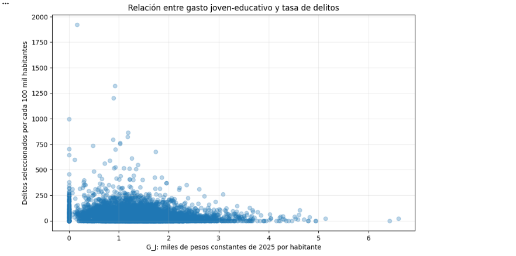
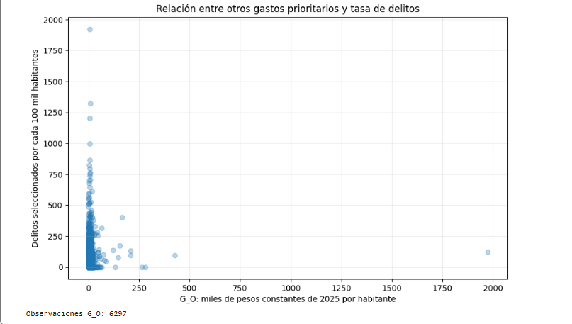
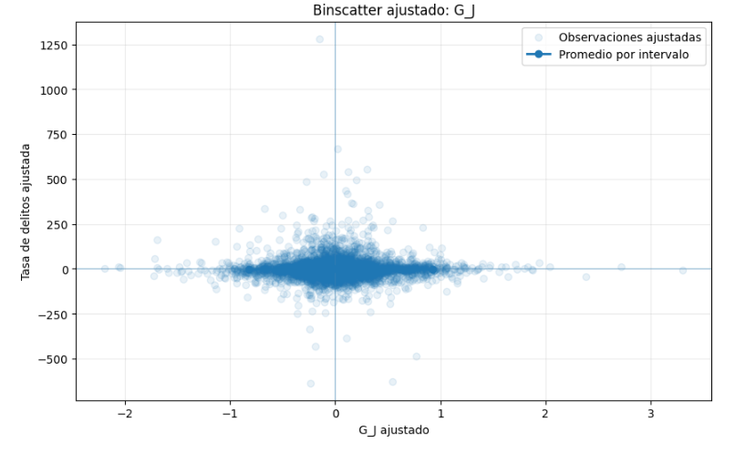
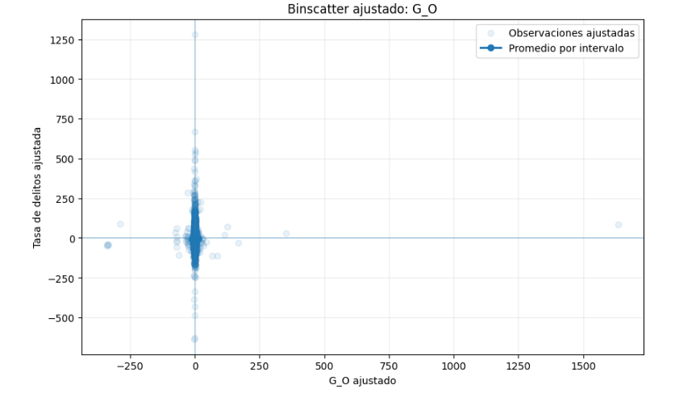
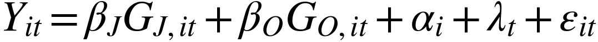
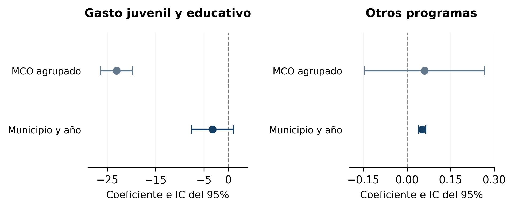
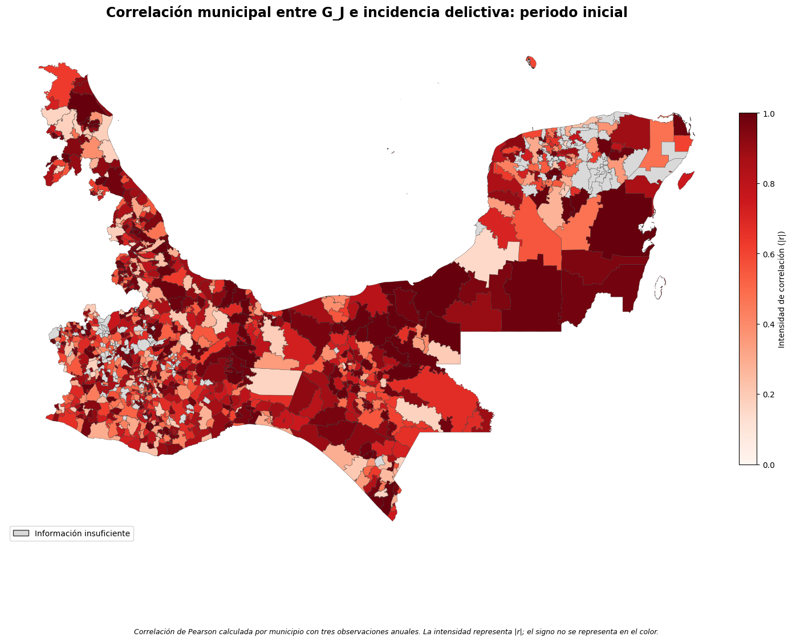
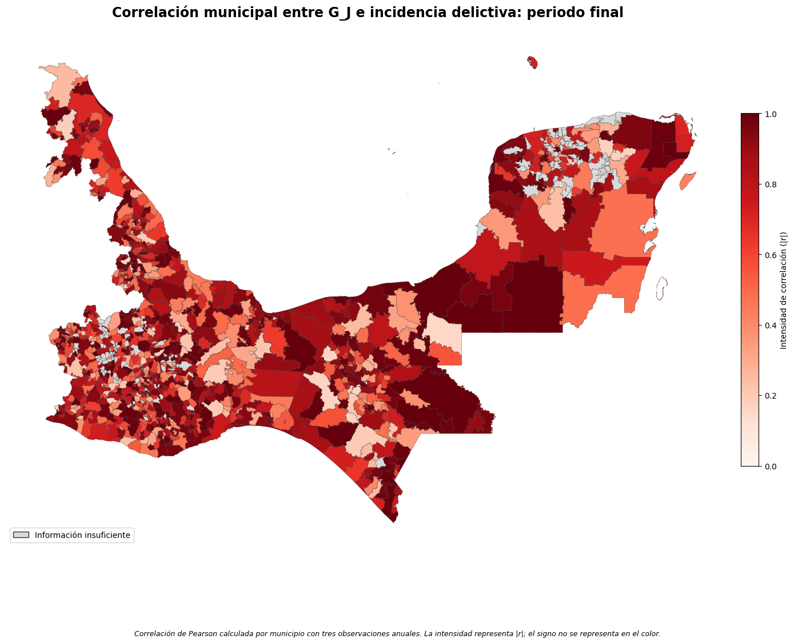

# Introducción 
Mi análisis busca determinar si el gasto público destinado a programas juveniles y educativos presenta una relación diferente con la incidencia delictiva respecto de otros componentes del gasto social de transferencias directas. Para responder esta pregunta, estimo primero modelos que relacionan ambos tipos de gasto con los delitos registrados en el mismo año. Posteriormente, realizo un ejercicio complementario para explorar cómo se relaciona el gasto actual con la incidencia delictiva observada dos años antes. Mi análisis abarca 1,052 municipios de siete entidades del sureste de México entre 2020 y 2024. La variable de resultado es una tasa por cada 100 mil habitantes construida con once rubros delictivos registrados por el Secretariado Ejecutivo del Sistema Nacional de Seguridad Pública.

La comparación entre modelos es importante porque los municipios no parten de las mismas condiciones. Algunos presentan mayores niveles de pobreza, distintas capacidades institucionales o problemas de seguridad más persistentes. Estas características pueden estar relacionadas tanto con los recursos públicos que reciben como con sus niveles de delincuencia. 

Como lo muestro más adelante en el estudio, la asociación negativa del gasto juvenil y educativo se atenúa al pasar de la regresión agrupada al modelo con efectos fijos de municipio y año. En este último, la diferencia estimada entre las dos pendientes es negativa, pero no puede distinguirse el valor de cero con la inferencia disponible. En un ejercicio aparte, lo que planteo es relacionar el gasto con delitos registrados dos años antes, debido a que, como parte de la política de atención a las causas, en teoría, la cobertura de los programas destinados a jóvenes responde de manera rezagada temporalmente a los patrones de incidencia delictiva en esos territorios. La especificación ponderada por población arroja una diferencia positiva, lo cual, describe una asociación retrospectiva, no un efecto del gasto sobre delitos posteriores.

## Por qué el gasto juvenil y educativo podría asociarse con menos delitos

Los programas sociales dirigidos a jóvenes y estudiantes pueden influir en algunos de los factores relacionados con la delincuencia mediante distintos mecanismos. Para entender esta relación, es importante distinguir entre los beneficios económicos que reciben directamente las personas y los cambios que esos apoyos podrían generar en sus oportunidades educativas y laborales.

El primer mecanismo puede entenderse en la relación de como recibir un subsidio puede ayudar a cubrir gastos que dificultan la permanencia escolar o la participación en actividades de capacitación. Por ejemplo, una beca puede utilizarse para pagar el transporte, adquirir materiales escolares o compensar parcialmente los ingresos que una persona deja de obtener por dedicar tiempo a estudiar. En este caso, el apoyo permite aliviar una restricción económica inmediata, aunque eso no significa necesariamente que cambie su trayectoria educativa o laboral. El segundo mecanismo se relaciona con la acumulación de capital humano. Este concepto se refiere a los conocimientos, habilidades y experiencia que una persona desarrolla y que pueden mejorar sus oportunidades de empleo e ingresos futuros. Si un programa contribuye a que los jóvenes permanezcan más tiempo en la escuela, terminen sus estudios o adquieran experiencia laboral, también podría ampliar sus oportunidades de obtener ingresos mediante actividades legales. Esta relación es relevante para los modelos económicos del delito. Ehrlich (1973) y Lochner (2004) explican que las decisiones de participar en actividades delictivas pueden depender, entre otros factores, de las oportunidades disponibles fuera de ellas. En particular, el concepto de costo de oportunidad permite entender que dedicar tiempo a una actividad ilegal también puede implicar renunciar a ingresos u oportunidades que podrían obtenerse mediante el estudio o el trabajo. Desde esta perspectiva, si una persona tiene mejores posibilidades de conseguir y mantener un empleo, participar en ciertas actividades delictivas podría resultar relativamente menos atractivo. Sin embargo, esta explicación no supone que todas las personas respondan de la misma manera ni que las decisiones delictivas dependan exclusivamente de incentivos económicos.

También existe una diferencia temporal entre ambos mecanismos. Mientras que la transferencia económica puede beneficiar al hogar o al joven desde el momento en que recibe el apoyo, los posibles efectos relacionados con la educación y el empleo requieren tiempo. Además, para que estos últimos se produzcan, no basta con entregar recursos: es necesario que el programa contribuya efectivamente a mejorar la permanencia escolar, la capacitación o las oportunidades laborales.

Los programas que analizo permiten ilustrar esta diferencia. Las becas de educación básica y media superior buscan reducir algunas de las dificultades económicas que enfrentan los estudiantes y sus hogares para sostener sus trayectorias educativas. Por su parte, Jóvenes Construyendo el Futuro combina una transferencia económica con capacitación en centros de trabajo para personas de entre 18 y 29 años que no estudian ni trabajan al momento de postularse (STPS, 2023).

En este último caso, la capacitación podría facilitar la adquisición de habilidades, generar experiencia laboral y ampliar las relaciones de los participantes con personas y organizaciones fuera de su entorno habitual. Estos cambios podrían favorecer su incorporación posterior al mercado de trabajo. No obstante, los programas tienen poblaciones objetivo y mecanismos de intervención diferentes. Además, el monto de gasto registrado en un municipio no permite saber cuántos beneficiarios permanecieron en la escuela, cuántos terminaron su capacitación o cuántos consiguieron empleo. Por ello, aunque existen argumentos teóricos para esperar posibles efectos preventivos, el gasto por habitante no permite comprobar directamente que estos mecanismos se hayan producido.

Una consideración adicional es que, en México, la incorporación de jóvenes a organizaciones criminales no siempre puede explicarse como una decisión individual basada en la comparación entre ingresos legales e ilegales. La literatura sobre el reclutamiento criminal muestra que también intervienen las relaciones sociales, los vínculos comunitarios y distintas formas de coerción. A partir de entrevistas biográficas, Chomczyński y Guy (2021) analizan cómo determinadas experiencias compartidas y relaciones sociales pueden facilitar la incorporación de jóvenes a organizaciones criminales, incluyendo su participación en delitos graves como el secuestro y el homicidio. Por otra parte, Vega et al. (2026), mediante testimonios de familias desplazadas en Guerrero, documentan situaciones en las que el reclutamiento ocurre bajo amenazas. En estos casos, la participación en actividades criminales no puede entenderse únicamente como el resultado de una elección económica entre distintas oportunidades.

Esta distinción es importante para esta investigación. Mejorar las oportunidades educativas y laborales podría reducir algunos incentivos para participar voluntariamente en determinadas actividades delictivas, pero no necesariamente evitaría el reclutamiento mediante amenazas, violencia o coerción. Por tanto, considero que los programas juveniles y educativos pueden tener mecanismos preventivos plausibles, aunque sus efectos dependen del contexto y de las condiciones en que operan las organizaciones criminales.

Finalmente, debemos reconocer una limitación de los datos utilizados. Nuestra variable de resultado es la tasa municipal de delitos registrados, no una medida directa del reclutamiento de jóvenes por organizaciones criminales. Tampoco conocemos la edad de quienes cometieron los delitos ni su posible participación en los programas. En consecuencia, el reclutamiento criminal constituye uno de los mecanismos que podrían explicar una relación entre oportunidades juveniles y determinados delitos, pero no es un resultado que podamos identificar directamente con nuestra información. Además, no existe una razón para suponer que todos los tipos de delitos incluidos en la tasa respondan de igual manera a los apoyos educativos o laborales.

## Qué aporta la comparación con otros programas

El otro componente de gasto no es un grupo de control sin intervención. Las pensiones pueden dar mayor margen al presupuesto de hogares donde conviven distintas generaciones; el abasto a precios subsidiados puede reducir el costo de bienes básicos, y los apoyos productivos buscan fortalecer actividades que generan ingresos (CONEVAL, 2024; Secretaría de Agricultura y Desarrollo Rural, 2022). La diferencia es que esos programas no se organizan principalmente alrededor de la continuidad escolar o de la transición juvenil al trabajo. Si esas trayectorias fueran un canal preventivo importante y el gasto captara una ampliación efectiva de las oportunidades, cabría esperar una pendiente más negativa —o menos positiva— para el componente juvenil y educativo. Esa expectativa motiva el contraste entre pendientes, pero no fija de antemano su signo.

Los antecedentes empíricos ilustran por qué importa el contexto. En São Paulo, Chioda et al. (2016) aprovecharon la ampliación de Bolsa Família a adolescentes y encontraron una reducción del delito; los resultados son compatibles con cambios en el ingreso del hogar o en el entorno de pares, sin distinguir de manera concluyente entre ambos mecanismos. En localidades rurales mexicanas, el estudio de largo plazo de PROGRESA no encontró respaldo claro para una reducción de la violencia; la estimación para homicidios apuntó en dirección contraria, con incertidumbre (Zizumbo-Colunga, 2023). Son intervenciones y horizontes distintos. Para Jóvenes Construyendo el Futuro, Sumano Rodríguez y Reyes Figueroa (2025) documentan un descenso nacional de los homicidios posterior al inicio del programa, pero señalan que sus resultados estatales no permiten descartar otras explicaciones.

También importa cómo se asignan los apoyos. El programa federal de prevención social de 2022–2024 propuso impulsar la inscripción en Jóvenes Construyendo el Futuro en municipios con alto rezago y violencia (Secretaría de Seguridad y Protección Ciudadana, 2022, acción 1.1.2). Esa prioridad no demuestra cómo se distribuyó cada pago, pero permite entender por qué una intervención con potencial preventivo podría coincidir con tasas altas de delitos registrados. Es importante puntualizar que el modelo compara asociaciones territoriales en las que pueden coexistir esos procesos, no separa la prevención de la focalización ni estima un efecto distinto para cada programa o delito.

# Datos, medición y diseño

La unidad de análisis es el municipio-año. El ámbito comprende Campeche, Chiapas, Oaxaca, Quintana Roo, Tabasco, Veracruz y Yucatán, con 1,052 municipios y la geografía de INEGI de 2020 como referencia. De las 5,260 observaciones posibles, las especificaciones contemporáneas con ambos componentes de gasto utilizan 5,245 y las que incluyen solo el gasto juvenil y educativo utilizan 5,258. La diferencia de muestra debe tenerse en cuenta cuando se comparan los coeficientes.

Construyo la tasa a partir de la suma anual de once rubros: homicidio doloso, homicidio culposo, feminicidio, secuestro, tráfico de menores, rapto, robo a transportista, extorsión, despojo, trata de personas y narcomenudeo. Divido esa suma entre la población municipal y la expreso por cada 100 mil habitantes. La serie municipal del SESNSP, elaborada con la metodología de 2015–2025, recoge presuntos delitos asentados en averiguaciones previas o carpetas de investigación. La tasa no equivale al número de víctimas ni incluye los hechos que no quedaron registrados (SESNSP, 2026).

**Tabla 1. Composición de los grupos de gasto**

| Grupo de gasto | Programas considerados |
|:---|:---|
| **Juvenil y educativo (G_J)** | S072 Becas de educación básica, S280 Jóvenes Construyendo el Futuro, S311 Beca de educación media superior Benito Juárez. |
| **Otros programas seleccionados (G_O)** | S052 Abasto Social de Leche, S053 Abasto Rural, S176 Pensión para Personas Adultas Mayores, S286 Pensión para Personas con Discapacidad, S287 Sembrando Vida, S293 Producción para el Bienestar. |

La información presupuestaria procede de la base de subsidios directos a la población por municipio de la Secretaría de Hacienda y Crédito Público (SHCP). Utilizo la variable MONTO_PAGADO con corte al cuarto trimestre. La escala para ambos componentes es de miles de pesos constantes de 2025 por habitante. El denominador es la población municipal, no el número de personas beneficiarias. La clasificación agrupa programas por su orientación, no a las personas que reciben el pago por edad.

La población municipal se obtiene del Censo de Población y Vivienda 2020 y de la Encuesta Intercensal 2025, con interpolación lineal para 2021–2024 (INEGI). La preparación de los datos distingue los valores faltantes de los ceros y no distribuye entre municipios montos que carecen de desglose territorial. El apéndice E presenta la tipología por número de habitantes. Su categoría superior es un rango de población, no una delimitación metropolitana oficial.

Las figuras 1 y 2 reúnen dos diagnósticos del avance preliminar, la dispersión original y los promedios por intervalos de las variables residualizadas. Sirven para examinar la distribución de los datos, no para reproducir la muestra final de las regresiones contemporáneas. En la figura 1, las observaciones del gasto juvenil y educativo se concentran en el extremo bajo de la escala y se superponen, lo que dificulta leer una pendiente a simple vista. En el otro componente, unos pocos valores muy elevados amplían el eje horizontal y comprimen el grueso de las observaciones cerca del origen. Esos puntos justifican revisar la escala y la construcción del gasto por habitante, pero la gráfica no permite saber si corresponden a errores o a montos efectivamente registrados.

**Figura 1. Dispersión bruta entre gasto por habitante y tasa de delitos seleccionados**

::: {layout-ncol=2}

{width=100%}

{width=100%}

:::

Fuente: elaboración propia.

En la figura 2, los promedios por intervalo oscilan cerca de cero y no dibujan una pendiente pronunciada en la zona con más observaciones. El gráfico de los otros subsidios sigue mostrando una distribución asimétrica. Esto en un nivel de análisis meramente descriptivo, ya que al agrupar residuos puede ocultar rasgos de la relación original y no equivale a estimar una función flexible con los controles incorporados conjuntamente (Cattaneo et al., 2024).

**Figura 2. Dispersión residualizada y promedios por intervalos de gasto**

::: {layout-ncol=2}

{width=100%}

{width=100%}

:::

Fuente: elaboración propia.

# Estimando y especificación

La especificación principal aproxima linealmente la tasa municipal a partir de los dos componentes de gasto, con efectos fijos de municipio y año:

{width=100%}

En la ecuación, Yit es la tasa de delitos del municipio i en el año t, G_Jit y G_Oit son los dos componentes de gasto, α_i y λ_t son los efectos fijos, y ε_it es el término de error. Los efectos municipales absorben diferencias que permanecen constantes en cada municipio, los efectos anuales y cambios comunes a todo el panel. La regresión nos permite obtener la relación con una pendiente para cada tipo de gasto de subsidios a nivel municipal.

En la escala monetaria declarada, β_j indica cuánto difiere la tasa de delitos predicha, en delitos registrados por cada 100 mil habitantes, cuando el gasto juvenil y educativo difiere en mil pesos constantes por habitante, manteniendo fijos el otro gasto y los efectos incluidos en el modelo. β_o tiene la misma interpretación para el otro componente. El contraste principal es la diferencia entre ambas pendientes:

θ = β_j - β_o.

El modelo de referencia del plan daba el mismo peso a cada observación municipio-año. Como punto de comparación descriptivo, presento un modelo agrupado de mínimos cuadrados ordinarios (MCO), sin efectos fijos y con errores estándar. La salida contemporánea de PanelOLS indica efectos de municipio y año y covarianza agrupada o *clusterizada*, pero no permite confirmar ni la ponderación aplicada ni el nivel de agrupamiento de los errores. El informe distingue esa salida de la estimación retrospectiva identificada como ponderada por población.

Con el ajuste (HC3) que corrimos intentamos corregir por heterocedasticidad, pero no por la posible dependencia entre observaciones del mismo municipio. La inferencia por conglomerados atiende esa dependencia dentro de las unidades utilizadas para agrupar, bajo sus supuestos de validez (Cameron y Miller, 2015). Ponderar por población, en cambio, modifica la importancia relativa de las observaciones y puede cambiar la asociación que resume el modelo (Solon et al., 2015).

La hipótesis de igualdad de pendientes se refiere a H_0: θ = 0. Que un coeficiente sea estadísticamente significativo y otro no lo sea no demuestra que difieran (Gelman y Stern, 2006). Para calcular el error estándar del contraste se necesitan tanto las varianzas individuales como la covarianza entre ambos estimadores. Las especificaciones que incluyen solo G_J son secundarias: omiten el otro componente de gasto y utilizan una muestra ligeramente mayor. El ejercicio que proponemos en la sección 4.2 es distinto del modelo del avance que rezagaba el gasto un año. Las réplicas de bootstrap de ese avance tampoco se trasladan a la especificación contemporánea de 2020–2024.

# Resultados

**Tabla 2. Coeficientes e intervalos de confianza del 95% en los modelos contemporáneos**

| Especificación | N | β_j IC del 95% | β_o IC del 95% | Tipo de covarianza |
|:---|:---:|:---:|:---:|:---:|
| MCO agrupado Ambos gastos | 5,245 | −23.0668 [−26.391; −19.743] | 0.0599 [−0.147; 0.267] | HC3 |
| Efectos fijos de municipio y año Ambos gastos | 5,245 | −3.2458 [−7.5642; 1.0726] | 0.0517 [0.0388; 0.0647] | Clustered |
| MCO agrupado Solo G_J | 5,258 | −23.2536 [−26.578; −19.929] | No incluido | HC3 |
| Efectos fijos de municipio y año Solo G_J | 5,258 | −3.2159 [−7.5339; 1.1020] | No incluido | Clustered |

Los resultados muestran una diferencia importante entre las estimaciones agrupadas y aquellas que incorporan efectos fijos. En el primer modelo, el gasto juvenil y educativo tiene un coeficiente de −23.07, lo que indica una asociación negativa relativamente pronunciada con la incidencia delictiva. Sin embargo, cuando incorporamos efectos fijos de municipio y año, el coeficiente disminuye en magnitud hasta −3.25.

Para interpretar esta última cifra, considerando la escala de las variables utilizada en el estudio, un aumento de mil pesos reales por habitante en el gasto juvenil y educativo se asocia con aproximadamente 3.25 delitos registrados menos por cada 100 mil habitantes, manteniendo constante el otro componente del gasto y los efectos fijos incluidos en el modelo. Sin embargo, esta estimación debe interpretarse junto con su intervalo de confianza. El intervalo va de −7.56 a 1.07, por lo que incluye tanto valores negativos como valores ligeramente positivos. Esto significa que, aunque la estimación puntual sugiere una relación negativa, los datos no proporcionan evidencia estadística suficiente para descartar que la asociación sea nula.

Este resultado permite hacer una primera observación: una parte importante de la relación negativa encontrada en la regresión agrupada deja de observarse cuando el análisis se concentra en las variaciones dentro de los municipios a lo largo del tiempo. La diferencia es consistente con la importancia de considerar características municipales persistentes, aunque todavía debemos comprobar que ambas estimaciones sean plenamente comparables en términos de muestra y ponderaciones antes de atribuir todo el cambio a la incorporación de efectos fijos. En conjunto, los resultados sugieren que las asociaciones estimadas dependen de la manera en que se consideran las diferencias entre municipios. Sin embargo, la pregunta central de la investigación no consiste solamente en conocer el signo o la significancia de cada coeficiente, sino en determinar si la relación entre gasto e incidencia delictiva es diferente entre los dos grupos de programas.

##Diferencia entre las pendientes

En el modelo contemporáneo con efectos fijos, la diferencia entre los coeficientes reportados es:

θ = −3.2458 − 0.0517 = −3.2975.

La prueba relevante consiste en contrastar la hipótesis de que las dos pendientes son iguales. Esto requiere calcular el error estándar de su diferencia, que depende tanto de la incertidumbre individual de cada coeficiente como de la covarianza entre ambos estimadores.

La matriz de varianzas y covarianzas de la estimación no se encuentra disponible en las salidas conservadas, por lo que no es posible recuperar directamente la covarianza entre ambos estimadores ni reconstruir el intervalo de confianza exacto de la diferencia. En su lugar, se utilizan cotas matemáticas que permiten evaluar conservadoramente la incertidumbre del contraste, sin asumir independencia entre los coeficientes. Aun así, los errores estándar individuales permiten establecer límites para la incertidumbre del contraste. Con esta información, incluso bajo el escenario compatible con la menor incertidumbre, el estadístico de prueba no alcanzaría el valor crítico utilizado en un contraste convencional al 5% de significancia. Por tanto, con los resultados disponibles no es posible rechazar la hipótesis de igualdad entre las pendientes. El procedimiento se desarrolla en el apéndice D.

Este hallazgo tiene una implicación importante para la interpretación del estudio. Aunque el gasto juvenil y educativo presenta una pendiente estimada más negativa, no contamos con evidencia estadística suficiente para afirmar que su asociación con la incidencia delictiva sea diferente de la del resto del gasto considerado. Tampoco hay evidencia para concluir que ambos grupos de programas tienen efectos equivalentes. No encontrar una diferencia estadísticamente significativa no demuestra que esa diferencia no exista. Aun con la menor incertidumbre compatible con esos errores, La cota superior del estadístico de Wald en valor absoluto es aproximadamente 1.502, inferior al valor crítico de 1.96 para un contraste convencional al 5%.Por lo tanto, una prueba convencional al 5% no rechazaría la igualdad de pendientes. Esto no demuestra que sean iguales ni que la diferencia sea pequeña en términos sustantivos. El apéndice D presenta el cálculo.

## Asociación retrospectiva: gasto en el año t y delitos en t − 2

Como ejercicio complementario, relaciono el gasto de cada año con la tasa de delitos registrada dos años antes. El gasto de 2020 se empareja con los delitos de 2018, y el de 2024, con los de 2022. La muestra reportada comprende 5,242 observaciones de 1,052 municipios. Es importante explicar qué buscamos con este ejercicio, porque su interpretación es distinta de la de un modelo que pretende identificar efectos posteriores a una intervención. En este caso, los delitos ocurrieron antes de que se ejerciera el gasto con el que se relacionan. Por tanto, no podemos interpretar los coeficientes como un efecto del gasto sobre esa incidencia delictiva previa. Lo que podemos explorar es si existe un patrón estadístico entre las condiciones de inseguridad que presentaban los municipios y los recursos públicos que recibieron posteriormente.

Esta comparación resulta pertinente desde una perspectiva de política pública. Si los programas o subsidios se distribuyen considerando necesidades territoriales, es razonable investigar si los municipios que experimentaron mayores problemas de inseguridad terminaron recibiendo más recursos en los años siguientes. Sin embargo, una asociación entre ambas variables no permite demostrar que la incidencia delictiva haya sido utilizada como criterio de asignación.

El otro componente del gasto presenta un coeficiente negativo de −0.0289, con un intervalo de confianza de [−0.0411; −0.0167] y un valor p inferior a 0.001. Estos resultados describen las asociaciones individuales de cada componente. No permiten concluir, por sí solos, que ambas pendientes sean significativamente distintas entre sí.

Posteriormente, considero una estimación ponderada por población. La diferencia respecto de la versión sin ponderar consiste en que los municipios con más habitantes tienen mayor peso en el cálculo de los coeficientes. Esto modifica la manera en que resumimos la relación observada, pues ya no damos la misma importancia estadística a un municipio pequeño que a uno densamente poblado. En la estimación ponderada, el coeficiente del gasto juvenil y educativo aumenta a 5.7575 (IC del 95%: [0.3221; 11.1930]; p = 0.0379), mientras que el correspondiente al otro gasto es −0.0657 (IC del 95%: [−0.1441; 0.0127]; p = 0.1006).

A diferencia del modelo anterior, en esta especificación retrospectiva ponderada sí se dispone del contraste directo entre ambas pendientes:

θ̂ = 5.8232   EE = 2.7728

El error estándar es 2.7728 y el valor p es 0.0358. El intervalo de confianza del 95% va de 0.3870 a 11.2594, por lo que no incluye cero. Esto significa que, en la estimación retrospectiva ponderada, la diferencia entre las dos pendientes es estadísticamente significativa al nivel del 5%.

**Tabla 3. Estimaciones retrospectivas: gasto en /(t/) y tasa de delitos en \(t-2\)**

| Especificación | β_j | β_o | θ |
|:---|:---:|:---:|:---:|
| Sin ponderar | 3.0788 | −0.0289 | No mostrado |
| Ponderada por población  Efectos de municipio y año | 5.7575 | −0.0657 | 5.8232 |

Este ejercicio complementario introduce una consideración relevante para interpretar las estimaciones contemporáneas: la relación entre gasto e incidencia delictiva podría reflejar no solamente una asociación entre los recursos ejercidos y las condiciones de seguridad, sino también procesos de asignación presupuestaria relacionados con las condiciones que los municipios presentaban previamente. En particular, la diferencia positiva y estadísticamente significativa entre las pendientes en la especificación retrospectiva ponderada es compatible con la existencia de patrones diferenciados entre la incidencia delictiva previa y el gasto posterior en ambos grupos de programas. Sin embargo, este resultado no demuestra que la inseguridad haya determinado la asignación de recursos, ni permite identificar los criterios institucionales utilizados para distribuirlos.

Esta evidencia refuerza una precaución central del modelo principal: las asociaciones contemporáneas no deben interpretarse automáticamente como efectos del gasto sobre la incidencia delictiva, pues también podrían estar influidas por la respuesta presupuestaria a condiciones de inseguridad preexistentes. Además, dado que el contraste retrospectivo no resulta significativo en la especificación sin ponderar, su interpretación debe considerarse sensible al esquema de ponderación. En consecuencia, el ejercicio no sustituye ni invalida el modelo principal, sino que permite identificar una posible fuente de endogeneidad que debe tenerse presente al interpretar sus resultados.

## Interpretación conjunta

Las estimaciones contemporánea y retrospectiva permiten examinar dos dimensiones diferentes de la relación entre gasto público e incidencia delictiva. El primer modelo analiza cómo se relacionan las variaciones del gasto con los delitos registrados en el mismo año. En esta especificación, una vez que se incorporan los efectos fijos municipales y anuales, la asociación negativa del gasto juvenil y educativo se reduce considerablemente y deja de ser estadísticamente significativa. Además, no encontramos evidencia suficiente para sostener que su pendiente difiera de la del otro componente del gasto. Pero en el segundo modelo, utilizamos la información delictiva anterior al gasto y permite explorar una cuestión distinta, sobre si los recursos ejercidos posteriormente presentan alguna relación con los niveles de inseguridad que los municipios habían experimentado previamente, como una reacción del gobierno federal a los niveles de incidencia delictiva, dos años después.

En este caso, encontré una diferencia estadísticamente significativa entre las pendientes únicamente en la especificación retrospectiva ponderada que reporta el contraste directo. Este resultado sugiere que la relación observada depende también de la forma en que se ponderan las observaciones municipales.

No obstante, debo distinguir entre dos posibles mecanismos. Por un lado, es posible que las condiciones de inseguridad influyan en la distribución posterior de ciertos programas públicos. Por otro, es posible que tanto el gasto como la incidencia delictiva respondan a características económicas, sociales o institucionales que persisten o cambian dentro de los municipios. Con las variables y los modelos disponibles no podemos determinar cuál de estas explicaciones predomina.

Esta distinción también me ayuda a entender por qué las estimaciones retrospectivas no contradicen necesariamente la posibilidad de que algunos programas tengan efectos preventivos. Que los municipios con mayor incidencia previa reciban posteriormente más gasto es compatible con una política que busca atender territorios con mayores necesidades, pero no demuestra que esa política haya conseguido reducir la delincuencia.

# Comparación de especificaciones y diagnósticos

**Figura 3. Asociaciones estimadas en los modelos con ambos componentes de gasto**

::: {layout-ncol=2}}

{width=100%}
Fuente: elaboración propia.

La comparación entre especificaciones me permite valorar hasta qué punto los resultados dependen de las decisiones utilizadas para estimar el modelo. El cambio más importante aparece en el coeficiente del gasto juvenil y educativo. En la regresión agrupada, encuentro una asociación con la tasa de delitos considerablemente negativa. Sin embargo, al incorporar efectos fijos de municipio y año, el coeficiente se acerca a cero.

Este cambio es relevante porque los dos modelos aprovechan información de manera diferente. La regresión agrupada combina diferencias observadas entre municipios con cambios registrados a lo largo del tiempo. En cambio, el modelo con efectos fijos municipales permite descontar aquellas características propias de cada territorio que no cambian durante el periodo. Por ejemplo, si un municipio mantiene durante varios años una capacidad institucional relativamente alta y, al mismo tiempo, presenta determinados niveles de gasto y delincuencia, el modelo agrupado puede reflejar parte de esas diferencias territoriales. El modelo con efectos fijos busca concentrarse en las variaciones que ocurren dentro del municipio, aunque no elimina la influencia de otros factores que cambian con el tiempo.

En este sentido, interpretó la disminución del coeficiente como una señal que las diferencias persistentes entre municipios pueden ser importantes para comprender la asociación observada inicialmente. Sin embargo, las salidas disponibles no permiten verificar completamente la equivalencia de las observaciones y ponderaciones empleadas en ambas estimaciones. Por ello, considero que esta interpretación debe mantenerse como provisional.

El modelo que incluye únicamente el gasto juvenil y educativo muestra un patrón semejante. Su coeficiente pasa de −23.2536 en la regresión agrupada a −3.2159 cuando se incorporan efectos fijos. La similitud de este último coeficiente con el obtenido en el modelo que incluye ambos gastos resulta interesante. No obstante, las muestras no son exactamente iguales, por lo que no atribuyo la cercanía de las estimaciones exclusivamente a la poca influencia que pudiera tener la incorporación del segundo componente. También revisé los diagramas de dispersión y los promedios por intervalos utilizados durante la exploración de los datos. Estas herramientas ayudan a identificar concentraciones de observaciones, posibles valores extremos y diferencias en la distribución de las variables. Sin embargo, su utilidad es principalmente descriptiva y no sustituyen las pruebas necesarias para evaluar si la especificación econométrica representa adecuadamente la relación estudiada. Algo similar ocurre con los mapas de correlaciones presentados en el apéndice F. Estos permiten observar diferencias territoriales en la magnitud de determinadas asociaciones, pero fueron construidos con un número reducido de pares de años por municipio y representan el valor absoluto de las correlaciones.

Por tanto, considero que estos mapas no permiten identificar la dirección de las asociaciones ni establecer que los patrones sean estadísticamente diferentes entre tipos de municipios. En términos generales, mi análisis exploratorio aporta información sobre la heterogeneidad de los datos, pero todavía no constituye evidencia suficiente para sostener que la relación entre gasto e incidencia delictiva cambie sistemáticamente según el tamaño o las características territoriales de los municipios.

# Alcance y limitaciones

La principal limitación del estudio es que la distribución del gasto público entre municipios no puede considerarse aleatoria. Los recursos se asignan mediante reglas de operación, criterios administrativos, características de la población y decisiones institucionales. Muchos de estos factores también pueden relacionarse con la incidencia delictiva. Por ejemplo, un municipio con mayores niveles de pobreza puede recibir más recursos destinados a programas sociales y presentar, al mismo tiempo, condiciones de inseguridad diferentes de las de otros municipios. Si estas características influyen en ambas variables y no están suficientemente consideradas en el análisis, los coeficientes estimados pueden recoger relaciones que no corresponden exclusivamente al gasto.

Una segunda limitación está relacionada con la medición de la delincuencia. La variable que utilicé reúne distintos tipos de delitos que no necesariamente responden a los mismos factores ni tienen una frecuencia comparable. Esto implica que las variaciones en los delitos más frecuentes pueden tener una influencia importante sobre la tasa agregada, incluso cuando otros delitos presentan tendencias diferentes. Además, las estadísticas de incidencia delictiva dependen de que los hechos sean denunciados o conocidos por las autoridades y registrados adecuadamente. Por tanto, los cambios en la tasa pueden reflejar, variaciones en los delitos registrados como modificaciones en los procesos de denuncia o registro.

También considero pertinente examinar la posible dependencia espacial entre municipios. Las condiciones de seguridad y algunas actividades delictivas pueden extenderse más allá de los límites administrativos, de modo que las observaciones de municipios vecinos podrían estar relacionadas. Si existe esta dependencia y no se considera adecuadamente, la incertidumbre de las estimaciones podría quedar subestimada. 

Definí el periodo final de análisis en 2020–2024, después de excluir 2025 durante la exploración de los resultados. Esta decisión requiere documentarse explícitamente y acompañarse de ejercicios de sensibilidad para valorar su influencia sobre las conclusiones. Asimismo, reconozco que todavía no cuento con documentación completa sobre el contraste exacto de las pendientes, el procedimiento bootstrap actualizado ni la prueba conjunta de heterogeneidad por tipología municipal para la especificación contemporánea final.

# Qué evidencia cambiaría la conclusión

La conclusión estadística cambiaría si una corrección documentada de los datos o de la inferencia, aplicada a la misma pregunta, arrojara un intervalo para θ completamente por debajo o por encima de cero. La recuperación de la covarianza del modelo reportado permitiría calcular el intervalo exacto, pero no cambiaría el no rechazo convencional con los errores marginales actuales (apéndice D).

Antes de interpretar un resultado distinto, considero necesario distinguir las correcciones de medición de los cambios de estimando. Verificar duplicados, acumulados y denominadores puede corregir errores; asignar más peso a los municipios de mayor población, en cambio, responde a otra forma de resumir la asociación. Una estimación ponderada no sustituye a la de referencia solo porque arroje un intervalo que excluye cero.

Para sostener que la diferencia es pequeña sería necesario contar con un margen de relevancia justificado para la tasa agregada y con un intervalo suficientemente estrecho. El umbral del plan para homicidio doloso no se traslada directamente a este resultado. Una conclusión causal exigiría, además, una estrategia que separara la variación del gasto de las condiciones que orientan su asignación.

# Conclusiones

A partir de los municipios que analicé entre 2020 y 2024, el modelo con efectos fijos no permite concluir que los dos componentes de gasto se asocien de manera distinta con los delitos registrados en el mismo año. La asociación negativa del gasto juvenil y educativo es mucho menos pronunciada que en la regresión agrupada. Su pendiente estimada es menor que la del otro componente, pero la incertidumbre no permite afirmar que difieran ni que sean equivalentes.

El ejercicio retrospectivo añade un matiz: el contraste positivo en la especificación ponderada aparece al relacionar el gasto con delitos que ya habían sido registrados. Interpreto este resultado como compatible con una asignación que responda a necesidades previas o con condiciones locales que persisten en el tiempo, pero no distingue entre esas explicaciones. Por ello, no contradice la hipótesis de un posible efecto preventivo ni ofrece evidencia de que ese efecto exista.

Considero que el aporte del estudio es precisar qué se puede aprender de los montos municipales. Ayudar a sostener una trayectoria escolar o a iniciar una trayectoria laboral es una vía plausible de prevención; el gasto por habitante, por sí solo, no permite observar si esas trayectorias cambiaron ni si ello alteró la incidencia delictiva. Los resultados no justifican priorizar un grupo de programas sobre el otro con el argumento de que reduce más delitos, pero tampoco descartan beneficios preventivos. Para evaluar ese objetivo se necesitarían datos sobre quién recibe los apoyos, su continuidad escolar o laboral y una estrategia que permita separar la ampliación de la cobertura de las condiciones que motivaron su asignación.

# Referencias {.unnumbered}

::: {#refs}
:::

Cameron, A. C., y Miller, D. L. (2015). A practitioner’s guide to cluster-robust inference. Journal of Human Resources, 50(2), 317-372. https://doi.org/10.3368/jhr.50.2.317

Cattaneo, M. D., Crump, R. K., Farrell, M. H., y Feng, Y. (2024). On binscatter. American Economic Review, 114(5), 1488-1514. https://doi.org/10.1257/aer.20221576

Chioda, L., de Mello, J. M. P., y Soares, R. R. (2016). Spillovers from conditional cash transfer programs: Bolsa Família and crime in urban Brazil. Economics of Education Review, 54, 306–320. https://doi.org/10.1016/j.econedurev.2015.04.005

Chomczyński, P., y Guy, R. (2021). “Our biographies are the same”: Juvenile work in Mexican drug trafficking organizations from the perspective of a collective trajectory. The British Journal of Criminology, 61(4), 946–964. https://doi.org/10.1093/bjc/azaa092

Ehrlich, I. (1973). Participation in illegitimate activities: A theoretical and empirical investigation. Journal of Political Economy, 81(3), 521–565. https://doi.org/10.1086/260058

Gelman, A., y Stern, H. (2006). The difference between ‘significant’ and ‘not significant’ is not itself statistically significant. The American Statistician, 60(4), 328-331. https://doi.org/10.1198/000313006X152649

Instituto Nacional de Estadística y Geografía. (s. f.-a). Censo de Población y Vivienda 2020. https://www.inegi.org.mx/programas/ccpv/2020/

Instituto Nacional de Estadística y Geografía. (s. f.-b). Encuesta Intercensal 2025. https://www.inegi.org.mx/programas/eic/2025/default.html

Lochner, L. (2004). Education, work, and crime: A human capital approach. International Economic Review, 45(3), 811–843. https://doi.org/10.1111/j.0020-6598.2004.00288.x

Secretaría de Hacienda y Crédito Público. (s. f.). Subsidios directos a la población, por municipio [Conjunto de datos y metadatos]. https://www.datos.gob.mx/dataset/subsidios_directos_poblacion_municipio

Secretaría de Seguridad y Protección Ciudadana. (2022, 5 de diciembre). Programa Nacional para la Prevención Social de la Violencia y la Delincuencia 2022–2024. Diario Oficial de la Federación. https://dof.gob.mx/nota_detalle_popup.php?codigo=5673254

Secretaría del Trabajo y Previsión Social. (2023, 29 de diciembre). Reglas de Operación del Programa Jóvenes Construyendo el Futuro para el ejercicio fiscal 2024. Diario Oficial de la Federación. https://dof.gob.mx/nota_detalle_popup.php?codigo=5713234

Secretariado Ejecutivo del Sistema Nacional de Seguridad Pública. (2026). Datos abiertos de incidencia delictiva [Serie municipal con metodología 2015 a 2025]. https://www.gob.mx/sesnsp/acciones-y-programas/datos-abiertos-de-incidencia-delictiva

Solon, G., Haider, S. J., y Wooldridge, J. M. (2015). What are we weighting for? Journal of Human Resources, 50(2), 301-316. https://doi.org/10.3368/jhr.50.2.301

Sumano Rodríguez, J. A., y Reyes Figueroa, L. A. (2025). Impacto del programa Jóvenes Construyendo el Futuro en los homicidios dolosos en México. Frontera Norte, 37. https://doi.org/10.33679/rfn.v1i1.2404

Vega, N. N., García-Figueroa, G., Torres, R. M., y Herrera Martínez, E. (2026). Huir para protegerse: el reclutamiento forzado y el desplazamiento desde Guerrero, México. Migraciones Internacionales, 17. https://doi.org/10.33679/rmi.vi.3222

Zizumbo-Colunga, D. (2023). The unintended consequences of conditional cash transfer programs for violence: Experimental and survey evidence from Mexico and the Americas. Latin American Politics and Society, 65(3), 47–71. https://doi.org/10.1017/lap.2022.67

\appendix

# Apéndice A. Respuesta al referee {.unnumbered}
El cuadro registra la secuencia de decisiones y distingue lo que se propuso en el plan de lo que se documenta en el análisis final, así como las observaciones y sugerencias recibidas por Ignacio Rafael Camacho Mier y Terán, y su atención. 

**Tabla A1. Respuesta a los comentarios del referee**

| Sección del documento | Comentario del referee (síntesis) | Cómo se atiende |
|:---|:---|:---|
| Sección 4. Resultados | Los errores del MCO agrupado deberían agruparse por municipio («clustered»). | Se precisa que el MCO agrupado constituye una estimación inicial de referencia para documentar la asociación entre las variables, mientras que la inferencia principal se sustenta en el modelo con efectos fijos municipales y anuales, cuyos errores estándar se agrupan por municipio. Se reconoce que la corrección HC3 atiende la heterocedasticidad, pero no necesariamente la dependencia serial intramunicipal. Por esta razón, los resultados del MCO agrupado se interpretan con carácter exploratorio y no constituyen la base de las conclusiones inferenciales del estudio. |
| Sección 4.1. Diferencia entre las pendientes | Además de las pruebas de Wald, agregar la covarianza directamente de la matriz de varianzas y covarianzas de la estimación. | Se agradece la sugerencia. Se revisó la información de estimación disponible; sin embargo, las salidas conservadas no incluyen la matriz completa de varianzas y covarianzas necesaria para recuperar directamente la covarianza entre ambos estimadores. En consecuencia, se mantuvo el procedimiento de cotas matemáticas, que permite evaluar conservadoramente la incertidumbre del contraste sin asumir independencia entre los coeficientes. Se precisó en el documento que este procedimiento no sustituye una prueba de Wald basada en la matriz completa, sino que establece que, con la información disponible, no es posible rechazar la igualdad de pendientes al 5%. Se conserva así una interpretación prudente, sin atribuir precisión estadística que no puede verificarse. |
| Documento en general | El borrador abarca 11 páginas de texto principal, excediendo el límite de 8 páginas. | Se acepta la observación. Se realizará una revisión integral para ajustar la extensión del texto principal al límite de ocho páginas establecido por el programa, procurando condensar la exposición y priorizar los elementos indispensables para comunicar la pregunta de investigación, los datos, la estrategia de estimación y los resultados. No obstante, el ajuste deberá considerar el espacio necesario para presentar las tablas y figuras que sustentan los resultados, así como las precisiones metodológicas derivadas de las observaciones del referee. Se procurará trasladar el material complementario, las pruebas adicionales y los resultados de sensibilidad a los apéndices, sin sacrificar la claridad ni la transparencia del análisis. |
| Sección 4.2. Asociación retrospectiva: gasto en el año \(t\) y delitos en \(t-2\) | Tras presentar el ejercicio retrospectivo, explicar explícitamente qué implica el resultado para la interpretación del modelo principal. | Se atendió la observación mediante una ampliación de la interpretación del ejercicio retrospectivo. Se incorporó una explicación explícita de sus implicaciones para el modelo principal, señalando que la asociación entre incidencia delictiva previa y gasto posterior es compatible con posibles patrones de asignación presupuestaria relacionados con las condiciones de seguridad de los municipios. Asimismo, se precisó que este resultado no identifica los criterios de asignación ni establece causalidad. Se vinculó este hallazgo con la posible endogeneidad de las estimaciones contemporáneas y se acordó que la evidencia es sensible al esquema de ponderación. |
| Documento en general | Homogeneizar la redacción del documento, utilizando la primera persona del singular de manera consistente. | Atendido. Homogenicé la redacción de todo el documento, utilizando la primera persona del singular de manera consistente. |
| Documento en general | Se requiere ser más explícito al hablar de «la tasa» y utilizar «tasa delictiva». | Atendido. Precisé la referencia a la variable, utilizando el término «tasa delictiva» para evitar ambigüedades entre secciones. |
| Página 3 | Corregir «puntualizar». | Atendido. Corregí el término señalado en la página 3. |

# Apéndice B. Atención a las observaciones del preanálisis {.unnumbered}

Entre el plan de preanálisis y el trabajo final se tomaron varías decisiones metodológicas que se trasparentan aquí: 

## B.1. Desviaciones respecto del plan original {.unnumbered}

## B.1.1. Variable de resultado {.unnumbered}

El plan definía como resultado principal la tasa municipal de homicidio doloso por cada 100 mil habitantes. El informe final utiliza una tasa agregada de once rubros delictivos del SESNSP: homicidio doloso, homicidio culposo, feminicidio, secuestro, tráfico de menores, rapto, robo a transportista, extorsión, despojo, trata de personas y narcomenudeo. El ajuste amplía el fenómeno descrito, pero cambia el significado del estimando: ya no describe exclusivamente homicidios. La selección individual de los once rubros no fue preespecificada ni quedó justificada de manera separada en la bitácora. Se reconoce como cambio de diseño, no como una decisión tomada antes de examinar los datos. Véase la sección 2.

## B.1.2. Periodo de análisis {.unnumbered}

El periodo previsto era 2020–2025. Después de revisar los resultados preliminares se observó una caída importante de los registros disponibles para 2025, por lo que las regresiones contemporáneas finales se limitaron a 2020–2024. La intención fue evitar que una menor cobertura afectara la comparación temporal. 

## B.1.3. Universo y geografía municipal {.unnumbered}

El plan mencionaba 1,053 municipios, aunque también se hacía referencia a la geografía de 2020 y a un universo de 1,052. El análisis final fija 1,052 municipios de siete estados, sin incorporar al municipio de Dzitbalché de reciente creación. La decisión busca mantener la comparabilidad territorial del panel.

## B.1.4. Programas incluidos en los dos componentes {.unnumbered}

El plan incorporaba S283 (Jóvenes Escribiendo el Futuro) al gasto juvenil-educativo y no incluía S052 (Abasto Social de Leche) ni S053 (Abasto Rural) en el componente restante. El informe emplea GJ = S072 + S280 + S311 y GO = S052 + S053 + S176 + S286 + S287 + S293. Esta modificación altera la composición del gasto y, por tanto, el significado sustantivo de sus coeficientes. La tabla 1 registra la clasificación final, pero las fuentes disponibles no contienen una justificación técnica específica para cada incorporación o exclusión; por transparencia, se declara esa limitación.

## B.1.5. Estimando principal {.unnumbered}

El plan presentaba βJ como estimando principal, aunque la pregunta comparaba el gasto juvenil y educativo con otros programas. Para alinear el parámetro con esa pregunta se definió θ = βJ − βO como el contraste central, manteniendo el modelo conjunto con efectos fijos. 

## B.1.6. Errores estándar y bootstrap {.unnumbered} 

El protocolo contemplaba errores agrupados por municipio y 999 réplicas bootstrap. En las salidas finales, los modelos MCO agrupados reportan covarianza HC3 y los modelos de efectos fijos están marcados como Clustered, sin precisar el conglomerado. Para θ se presenta una cota algebraica de incertidumbre construida con los errores individuales.

## B.1.7. Ponderación por población {.unnumbered} 

El plan proponía dar igual peso a cada municipio-año y usar la ponderación por población como sensibilidad. La razón era comparar una asociación que atribuye el mismo peso a los municipios con otra que da mayor peso a los territorios poblados. La especificación retrospectiva incluye una variante explícitamente ponderada, pero las salidas contemporáneas disponibles no permiten confirmar qué pesos se aplicaron. Tampoco está comprobado que la estimación retrospectiva sin ponderar y la ponderada tengan exactamente los mismos controles. Por ello, no se atribuyen sus diferencias exclusivamente a los pesos. 

## B.1.8. Temporalidad de la especificación complementaria {.unnumbered} 

El plan propuso relacionar delitos en t con gasto en t − 1 para estudiar la asociación de recursos previos con resultados posteriores. El informe incorpora otro ejercicio que empareja gasto en t con delitos registrados en t − 2, por ejemplo, gasto de 2020 con delitos de 2018. Este ejercicio es retrospectivo, considero que puede permitir explorar si el gasto posterior se relaciona con condiciones de inseguridad previas, pero no estima un efecto del gasto sobre delitos ocurridos antes. Las estimaciones preliminares con gasto rezagado un año se conservan separadas de las finales. 

## B.1.9. Tipología municipal y heterogeneidad {.unnumbered} 

El plan definía el último grupo como metropolitano/conurbado por tamaño o pertenencia a una metrópoli. La clasificación finalmente utilizada conserva solamente rangos poblacionales: rural (≤5 mil), semiurbano (>5–50 mil), urbano (>50–300 mil) y más de 300 mil habitantes. En última instancia es una variable de concentración demográfica, más que una varibale constuida de manera territorial, por la continuidad de las aglomeraciones urbanas reconocidas en el Sistema Urbano Nacional. Se plantearon interacciones del gasto con la tipología, pero no hay una prueba conjunta de heterogeneidad documentada para el modelo contemporáneo final. 

## B.1.10. Umbral de relevancia sustantiva {.unnumbered} 

El plan proponía un umbral Δ = 2.5 homicidios por cada 100 mil habitantes por mil pesos de gasto juvenil y educativo. El resultado final utiliza una tasa agregada de once delitos y el contraste principal es θ, no solo βJ. Trasladar el mismo umbral sin justificación cambiaría su significado. Por ello, no se aplica automáticamente Δ ni se afirma equivalencia entre pendientes; se reconoce que falta definir un margen de relevancia adaptado a la nueva variable y al contraste principal. 

## B.1.12. Limitaciones de tiempo y alcance del proyecto {.unnumbered} 

Durante el avance se construyeron dispersiones, promedios por intervalos de variables residualizadas y mapas municipales de correlaciones. Su propósito es explorar valores extremos y heterogeneidad espacial, pero no es posible ir más a detalle ni mucho más fino en el análisis para intentar mostrar causalidad. Por cuestiones de tiempo y alcance del proyecto, los gráficos disponibles se presentan como exploratorios y sus límites se explican en las secciones 2, 5 y 6, así como en el apéndice F del informe original. 

# Apéndice C. Resultados y verificaciones complementarias {.unnumbered}

Estas salidas documentan la evolución del análisis. Las especificaciones preliminares no corresponden a la muestra definitiva de los modelos contemporáneos.

## C.1. Regresiones preliminares documentadas en la bitácora {.unnumbered}

**Tabla X. Comparación de especificaciones y modelos con rezagos**

| Modelo | N | β_J | β_O | Contraste θ | Conclusión reportada |
|:---|---:|---:|---:|:---|:---|
| Básico, sin ponderar (2020–2025) | 5,776 | 0.322293 | 0.050179 | 0.272113; p = 0.886 | No se rechaza igualdad de pendientes. |
| Básico, ponderado | 5,776 | 8.055282 | 0.091769 | 7.963513; p < 0.001 | Diferencia positiva significativa. |
| Gasto rezagado 1 año, sin ponderar | 5,247 | 0.092384 | −0.032483 | 0.124866; p = 0.966 | Sin diferencia significativa. |
| Gasto rezagado 1 año, ponderado | 5,247 | 7.930121 | 0.003498 | 7.926622; p = 0.015 | Diferencia positiva significativa. |

## C.2. Ejercicio retrospectivo {.unnumbered}

El ejercicio que empareja gasto en t con delitos en t − 2 se reporta en la sección 4.2 y en la tabla 3. Se distingue de las estimaciones preliminares de este apéndice, en las que se rezagaba el gasto un año.

## C.3. Cobertura y tipología {.unnumbered}

**Tabla X. Distribución de municipios por categoría poblacional**

| Categoría municipal | Criterio | Municipios |
|:---|:---:|---:|
| Rural | ≤5,000 habitantes | 471 |
| Semiurbano | >5,000 y ≤50,000 | 474 |
| Urbano | >50,000 y ≤300,000 | 98 |
| Más de 300 mil | >300,000 habitantes | 9 |
| **Total** | | **1,052** |

# Apéndice D. Exploración inicial del análisis territorial {.unnumbered}

## D.1. Mapas de correlación municipal {.unnumbered}

Los mapas representan correlaciones de Pearson por municipio entre el gasto juvenil y educativo y la tasa de delitos seleccionados. La primera ventana empareja el gasto de 2020–2022 con los delitos de 2018–2020; la segunda, el gasto de 2022–2024 con los delitos de 2020–2022. Cada correlación se basa en tres pares anuales, de modo que un solo año puede influir notablemente en el resultado.

Los tonos rojos muestran la magnitud absoluta de la correlación, no su signo. El gris indica que no hay información suficiente para estimarla.

{width=100%}
**Nota:** gasto de 2020–2022 y delitos de 2018–2020.

{width=100%}
**Nota:** gasto de 2022–2024 y delitos de 2020–2022.

# Réplica los resultados {.unnumbered}

## Código {.unnumbered}

Consulta el código en el siguiente enlace de google colab: https://colab.research.google.com/drive/1NyjPljqVXTcdiPoVFimGm9X9CeSoghTD?usp=sharing 

## Bases de datos {.unnumbered}

Consulta las bases de datos en la siguiente carpeta de Google Drive:

https://drive.google.com/drive/folders/1MwRxWLrxykk8ylPgUL1OfwTzqJzUTwHi?usp=sharing 

Nota: En caso de tener probelmas con la base del SESNSP puede ser descargada en:

https://www.gob.mx/sesnsp/acciones-y-programas/datos-abiertos-de-incidencia-delictiva 
